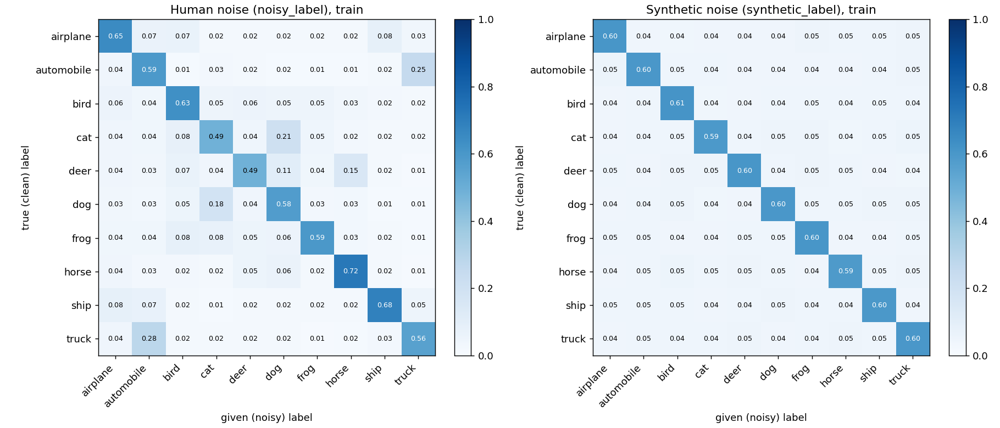
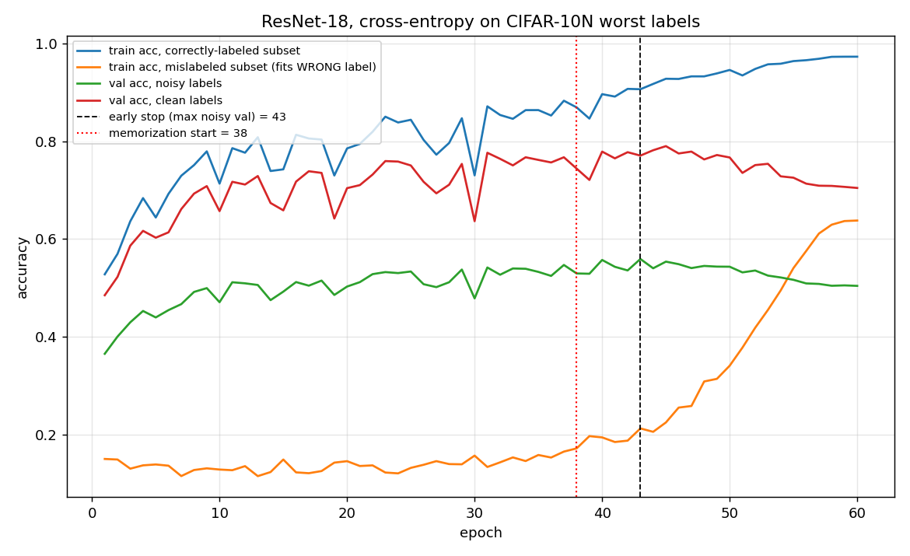

# Learning from Messy Human Labels – CIFAR-10N (worst)

Inter-IIT Tech Meet 15.0 · CV Selection Bootcamp · Mihir Gune (24b2443)

Training a ResNet-18 (from scratch, 60 epochs) on CIFAR-10 images whose training labels come from crowd
workers and are **40% wrong**, finding the mislabeled images, and comparing human noise with random
(synthetic) noise.

| | result |
|---|---|
| Noise rate (train) | 40.24% – concentrated on automobile↔truck, cat↔dog, deer↔horse, airplane↔ship |
| Clean-label reference / plain CE on noisy labels | 94.5% / 70.5% clean val (77.1% early-stopped) |
| Memorization of wrong labels starts at | epoch 38 (early stop at 43, chosen with noisy val) |
| Mislabel detection (Task 3, AUM) | AUROC **0.966**, precision@k **0.882** |
| Best robust method (Task 4): **ELR + mixup, 2 networks** | noisy val **59.22%** · clean val **89.5%** |
| Same method on synthetic noise (Task 5) | clean val 92.5% (CE baseline 74.0%) |

Clean-label accuracies are measurements only. Every model and epoch was **selected with noisy validation labels**
(synthetic labels in Task 5), as the rules require. With ~40% wrong validation labels a perfect model would
score only ~59–60% noisy val.

## Repository layout

```
├── README.md                 this overview
├── report.md                 answers to Q1–Q5 (≤ 100 words each)
├── results.json              settings and validation numbers (submission template, filled)
├── predictions/              the 10 submitted prediction files (t1_*, t2_*, t3_*, t4_*, t5_*)
├── models/                   weights of the submitted networks (fp16, ~21 MB each)
├── code/                     all scripts – see code/README.md for every command
│   ├── train.py              single-network trainer (CE/GCE/SCE, mixup, ELR, SOP, forward-T, relabel, CV folds)
│   ├── coteach.py dividemix.py elrplus.py   two-network methods
│   ├── task2_analyze.py task3_scores.py task4_targets.py ...   task-specific analysis
│   ├── README_submission.md  the README shipped inside the submission zip
│   └── kaggle/               run any job list on Kaggle GPUs from a local machine
├── results/
│   ├── runs/<run>/           config + per-epoch log of every training run (81 runs)
│   ├── tables/               ranked runs, Task 3 signals, real-vs-synthetic, confusion matrices
│   ├── analysis/             figures + analysis.json of the final data analysis
│   └── figures/              noise matrices, memorization curves
├── docs/EXPERIMENTS.md       everything that was tried, with results and the reason for each decision
├── docs/ANALYSIS.md         final data analysis: labels, images, dynamics, selection, detector, final model
├── data/README.md            where to put the provided bootcamp files (dataset not committed – too large)
├── check_format.py           provided format checker
└── requirements.txt
```

## Data

The dataset is **not included in this repository**: `train_images.npy` alone is 153 MB, above GitHub's 100 MB
per-file limit (≈185 MB in total), and it is the bootcamp's provided data (CIFAR-10 images with CIFAR-10N
labels). Place the provided files in `data/` as described in [`data/README.md`](data/README.md).

## Model weights

`models/` holds the weights of every network behind a submitted prediction file – 11 ResNet-18s, final epoch
(60), stored in fp16 (~21 MB each; load with `code/predict.py`, which casts back to fp32).

| prediction file | weights | reproduced by the weights |
|---|---|---|
| `t1_clean_ref.csv` | `t1_clean_ref.pt` | exactly (final epoch) |
| `t1_noisy_ce.csv` | `t1_noisy_ce.pt` | exactly (final epoch) |
| `t2_early_stop.csv` | – | from epoch 43 of the same run (per-epoch predictions were saved during training; only final weights were kept) |
| `t4_elr_mixup.csv` | `t4_elr_mixup_seed0.pt` + `_seed1.pt` | file is the best noisy-val epoch (58); weights are epoch 60 (noisy val 59.14 vs 59.22) |
| `t4_cv_relabel_mixup.csv` | `t4_cv_relabel_mixup_seed0.pt` + `_seed1.pt` | file is epoch 55; weights are epoch 60 |
| `t4_gce_mixup.csv` | `t4_gce_mixup_seed0.pt` + `_seed1.pt` | file is epoch 54; weights are epoch 60 |
| `t5_baseline_synth.csv` | `t5_baseline_synth.pt` | exactly (final epoch) |
| `t5_best_synth.csv` | `t5_elr_mixup_synth_seed0.pt` + `_seed1.pt` | exactly (best epoch = 60) |

```bash
python code/predict.py --weights models/t5_elr_mixup_synth_seed0.pt models/t5_elr_mixup_synth_seed1.pt --out t5_best_synth.csv
```
Checked against the predictions saved during training: 99.93–99.99% identical (a few borderline test images
change because of fp16 rounding).

## Approach

**Recipe (fixed for every run).** Provided ResNet-18 from scratch; SGD + Nesterov momentum 0.9, weight decay
5e-4, batch 128, OneCycle cosine learning rate (peak 0.1), 60 epochs; random crop + horizontal flip; seed 0.

**Task 1 – the noise.** Noisy vs clean labels on the training set give the noise rate and the 10×10 matrix:
human errors pile onto look-alike classes, synthetic errors are uniform.



**Task 2 – memorization.** For ~37 epochs the network ignores wrong labels (it still predicts the true class
for ~65% of mislabeled images); from epoch 38, as the learning rate decays, it memorizes them (agreement with
wrong labels 13% → 64%) and clean accuracy drops. Early stopping on noisy validation picks epoch 43.



**Task 3 – finding mislabeled images.** Six signals were compared (five-fold cross-validated losses and margins,
in-sample losses). The submitted score is **AUM**: the margin between the strongest other class and the given
label, averaged over the epochs before memorization. Feature-space kNN, centroid distances, hand-crafted
features (LBP, GLCM, HOG) and look-alike pairs were also evaluated (`docs/EXPERIMENTS.md`, section 3).

**Task 4 – robust training.** About 40 configurations (49 noisy-label runs including 2-network averages) across robust losses (GCE, SCE), loss correction (forward T
estimated without clean labels), regularization (label smoothing, mixup, ELR), sample selection (co-teaching),
label correction (relabelling with held-out cross-validation predictions), per-sample noise modelling (SOP) and
semi-supervised hybrids (DivideMix, two-network ELR). Each method may use 2 networks; independently trained
pairs are averaged. Submitted: the three method families with the highest **noisy** validation accuracy.

| submitted method | noisy val | clean val (measured) |
|---|---|---|
| **ELR + mixup** (best) | **59.22** | **89.5** |
| CV relabel + mixup | 59.14 | 86.2 |
| GCE + mixup | 58.96 | 85.1 |

ELR keeps a running average of each image's past predictions and adds `λ·log(1 − ⟨p, target⟩)` to the loss;
early predictions mostly reflect the true class, so the term cancels the gradient that pulls the network toward
a wrong label. Mixup blends image pairs so no single label can be memorized. Fit to wrong labels drops from 64%
to 12%, and 79% of mislabeled training images get their true class.

**Task 5 – real vs synthetic noise.** The method ranking is the same on both, but synthetic noise is easier for
every method (CE early-stopped 83% vs 77% clean), and the methods gain more on human noise (+12.4 vs +9.2
points). Humans mislabel the *hard* images: 52% of the hardest fifth of validation images are mislabeled by
humans versus 37% of the rest, while random noise is flat (44% vs 40%).

## Key findings
Full analysis with 11 figures: [`docs/ANALYSIS.md`](docs/ANALYSIS.md).

1. Human noise is structured twice over: **which classes** (look-alike pairs) and **which images** (ambiguous
   ones). The second is why it is harder to learn, detect and correct than random noise.
2. Noisy validation accuracy saturates near 59% and cannot recognise models that *correct* annotator errors
   (DivideMix: 89.3% clean, lower noisy val). A transition-matrix correction of the validation score does not fix
   this because the noise is instance-dependent. All selections nevertheless follow the noisy-label rule.
3. Mixup was the single most useful ingredient; ELR + mixup reached 89.5% clean accuracy within the
   60-epoch / 2-network budget.
4. SGD beat AdamW, which starts memorizing wrong labels ~15 epochs earlier.

## Reproducing
```bash
pip install -r requirements.txt
# put the provided files in data/ (see data/README.md; the dataset is not in the repo), then follow code/README.md, e.g.
python code/train.py --label noisy --name t1_noisy
python code/make_submission.py --roll_no 24b2443 --name "Mihir Gune" --t5_best_run t5_elr_mix1_synth_ens
```
A Tesla T4 takes ~17 s per epoch (~18 min per 60-epoch run). `code/kaggle/` runs the same commands on
Kaggle GPUs.

## Rules followed
* Provided ResNet-18 only, trained from scratch; no external data or pretrained weights; no test labels.
* ≤ 60 epochs per network, ≤ 2 networks per method, 5 training runs for Task 3 (cross-validation folds).
* One training recipe for all runs; method-specific changes (mixup, losses, targets) are the methods themselves.
* Clean labels only for the Task 1 reference model and for measurements; never to train, filter, relabel or
  select in Tasks 2–5. Selection by noisy validation (Tasks 1–4) and synthetic validation (Task 5).
