# Final data analysis

`python code/data_analysis.py --out results/analysis` regenerates every figure below and `results/analysis/analysis.json`
(every number quoted here). This is **measurement only**: nothing is trained or selected; clean labels are used to
measure, never to choose.

---

## A. The labels

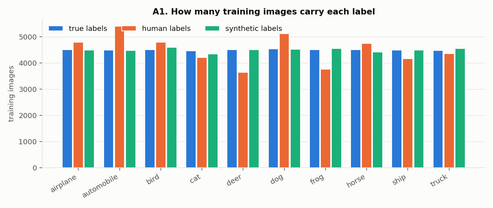

**Annotators have class preferences.** The true classes are balanced (≈4,500 each), but human labels are not:
"automobile" is used 5,414 times (+20%) and "dog" 5,130 (+13%), while "deer" (3,636, −19%) and "frog" (3,770, −16%)
are under-used. Synthetic labels stay balanced. A model trained on human labels inherits these priors.

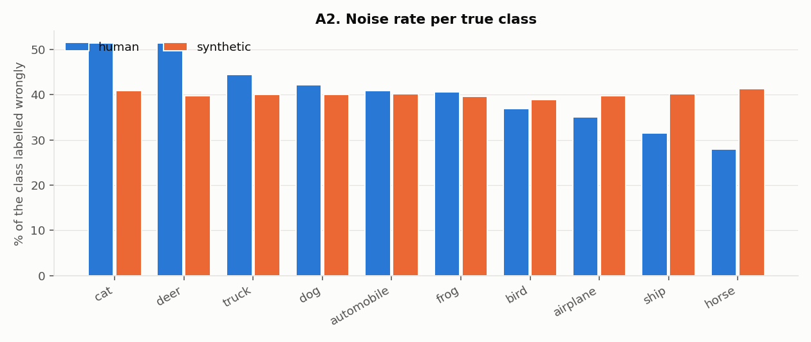

**Noise rate per true class.** Human: cat 51.5%, deer 51.4%, truck 44.5%, dog 42.2% … horse 28.0%. Synthetic: flat
39–41% for every class.

**The confusions are often one-directional** (true → given):

| pair | → | ← |
|---|---|---|
| automobile ↔ truck | 1,126 | 1,247 |
| cat ↔ dog | 924 | 834 |
| deer ↔ horse | **683** | 233 |
| deer ↔ dog | **491** | 183 |
| bird ↔ frog | 222 | **373** |
| airplane ↔ ship | 379 | 369 |

Deer are called "horse" or "dog" three times more often than the reverse: annotators default to the more familiar
animal.

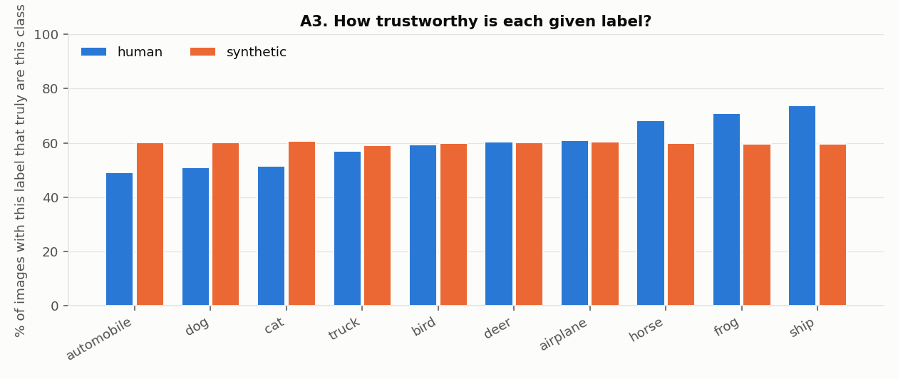

**How trustworthy is each human label?** Only 49% of images labelled "automobile" are automobiles, 51% of "dog" and
52% of "cat"; "ship" (74%), "frog" (71%) and "horse" (68%) are the most reliable. Every synthetic label is ~60% pure.

## B. The images

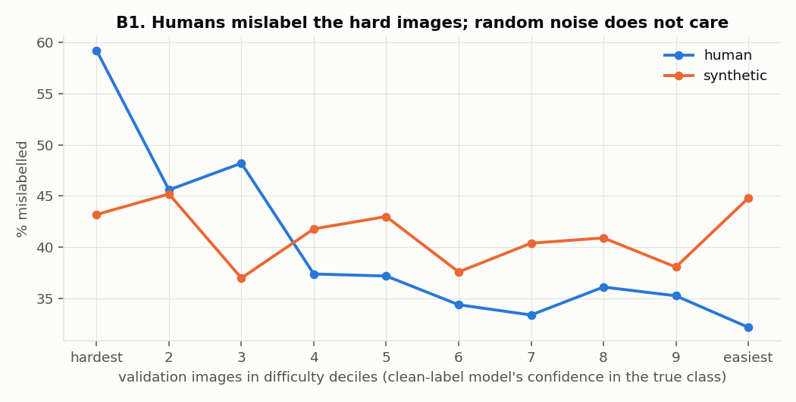

**Humans mislabel the hard images.** Difficulty = the clean-label model's confidence in the true class on validation
images it never trained on. Human mislabel rate falls from 59% in the hardest decile to 32% in the easiest; synthetic
noise stays between 37% and 45% with no trend.

**"Hard" is semantic, not photometric.** Low-level image statistics barely separate mislabelled from correct images:

| statistic | human: wrong vs correct | AUROC (human) | AUROC (synthetic) |
|---|---|---|---|
| brightness | 0.462 vs 0.482 | 0.546 | 0.501 |
| contrast | 0.194 vs 0.195 | 0.508 | 0.501 |
| colourfulness | 0.130 vs 0.133 | 0.512 | 0.503 |

Mislabelled images are only marginally darker, and the mislabel rate is flat across contrast deciles (39–42%). What
makes an image hard is ambiguity of *content* (pose, crop, look-alike class), which is also why hand-crafted texture
features could not find the wrong labels (Task 3 experiments).

## C. Training dynamics

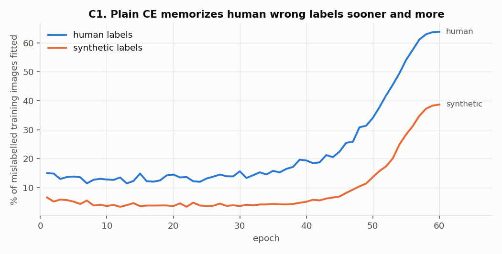

**Human wrong labels are memorized sooner and more.** With plain CE, the share of mislabelled training images fitted
to their wrong label passes 30% at epoch 48 (human) vs 56 (synthetic) and ends at **63.8% vs 38.7%**. Plausible
wrong labels are easier to fit than random ones.

**Which classes get memorized** (epoch 60, share of each true class's mislabelled images fitted to the wrong label):
cat 77%, deer 73%, dog 73%, airplane 68%, bird 66%, truck 64%, frog 59%, ship 55%, horse 52%, automobile 41%.

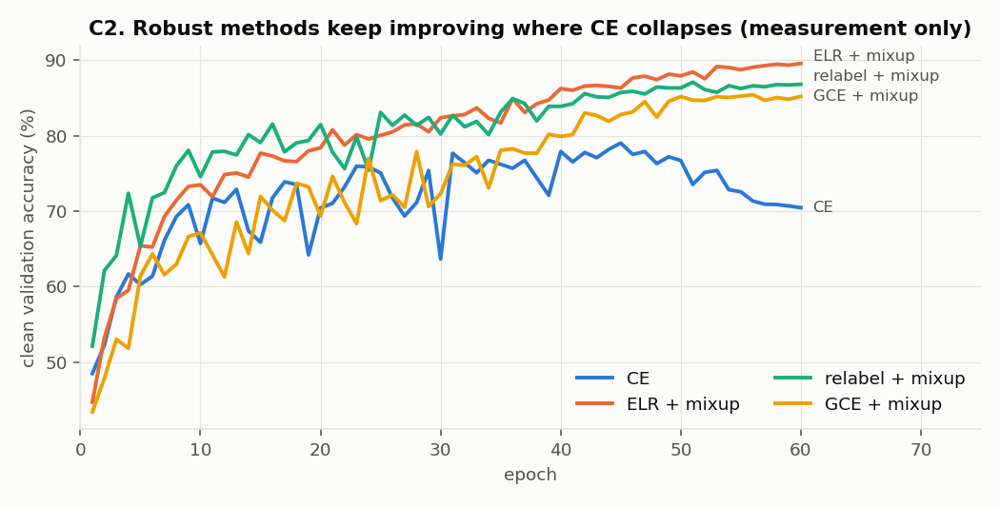

**Robust methods keep improving where CE collapses.** All four track each other until ~epoch 35; from the memorization
point CE drops from 79% to 70.5% clean accuracy while ELR + mixup keeps climbing to 89.5%.

## D. Model selection with noisy labels

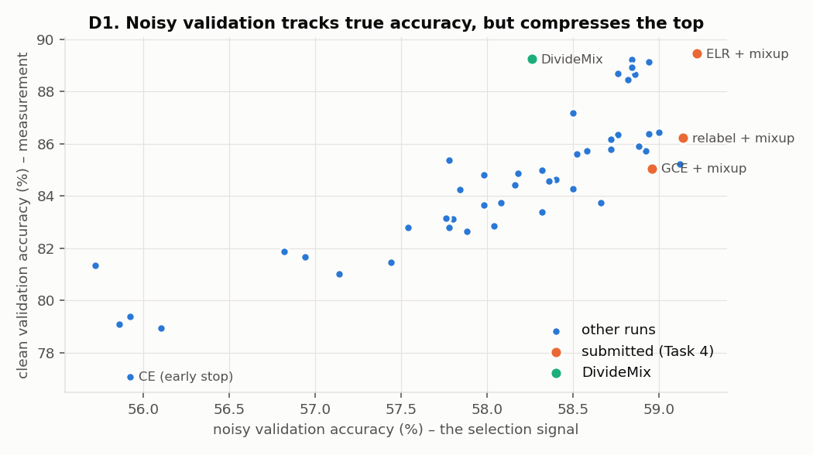

Across 49 noisy-label runs, noisy validation accuracy ranks models well overall (Spearman 0.85 with clean accuracy),
but **the top is compressed**: runs between 58.0% and 59.2% noisy val span 82.9%–89.5% clean. Noisy val is capped
near 59–60% (40% of its labels are wrong) and rewards agreeing with annotator mistakes, so DivideMix (89.3% clean)
ranks below simpler methods. The submitted ELR + mixup sits at the top on both axes.

## E. The Task 3 noise detector (AUM)

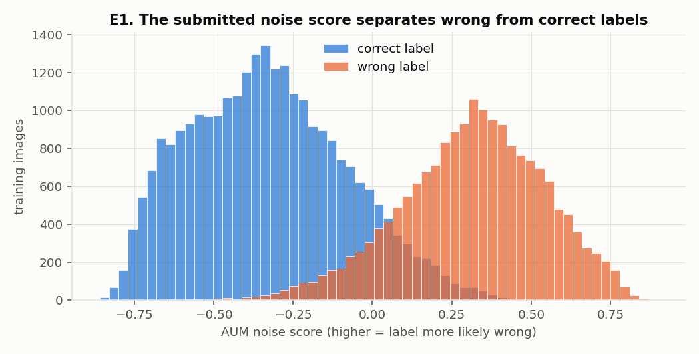

AUROC 0.966. By given label the detector is weakest on "cat" (0.926) and "dog" (0.933) – the look-alike pair – and
near-perfect on "automobile" (0.988), "ship" (0.987), "airplane" (0.986) and "truck" (0.986).

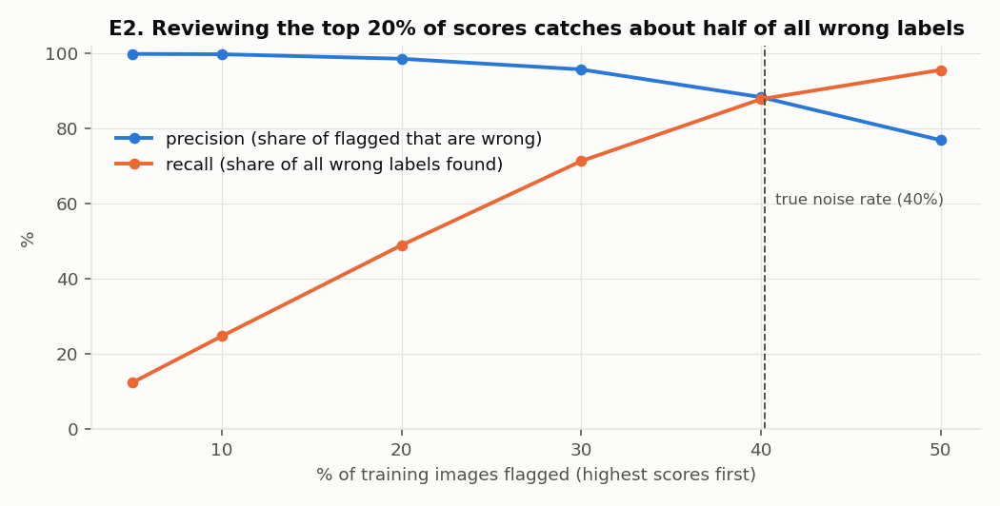

| images flagged | precision | recall |
|---|---|---|
| top 5% | 99.9% | 12.4% |
| top 10% | 99.8% | 24.8% |
| top 20% | 98.6% | 49.0% |
| top 30% | 95.8% | 71.4% |
| top 40% (≈ noise rate) | 88.4% | 87.9% |
| top 50% | 77.0% | 95.6% |

A practical reading: relabelling only the top 20% of scores would fix half of all wrong labels with almost no false
alarms.

## F. The final model (ELR + mixup)

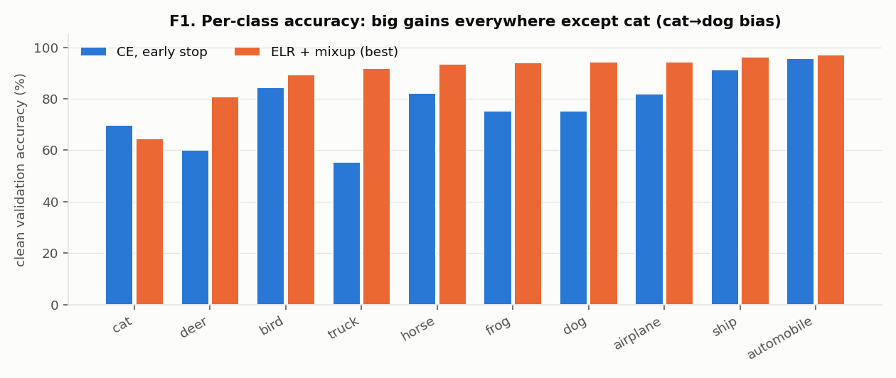

Clean validation accuracy per class, early-stopped CE → ELR + mixup: truck 55 → 92, frog 75 → 94, dog 75 → 94,
deer 60 → 81, airplane 82 → 94, horse 82 → 94, ship 91 → 96, bird 84 → 89, automobile 96 → 97 – and **cat 70 → 64**,
the only class that gets worse.

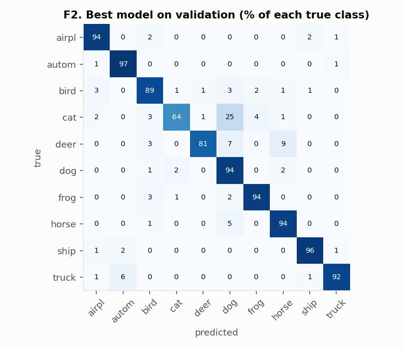

**The remaining errors are the human confusions.** Top validation mistakes of the best model: cat→dog (132),
deer→horse (43), truck→automobile (33), deer→dog (33), horse→dog (23). The model learned the annotators' preference
for "dog": on the test set it predicts 1,359 dogs and only 668 cats, versus 1,037 / 949 for the clean-label reference.
"Cat labelled dog" is the one confusion the method could not undo – only 44% of mislabelled training cats are
recovered, against 79% overall.

**Label correction on the training set** (ELR + mixup network at its selected epoch):
* 78.6% of mislabelled training images are predicted as their **true** class (plain CE at epoch 60: 24.7%),
  by class: automobile 96%, ship 92%, frog 89%, dog 87%, horse 85%, truck 82%, airplane 81%, bird 79%, deer 67%,
  cat 44%;
* 96.2% of correctly labelled images keep their label.

**Test-set sanity check** (no test labels used): agreement of each submitted file with the clean-label reference
model – t4_elr_mixup 89.6%, t4_cv_relabel_mixup 86.9%, t4_gce_mixup 85.3%, t2_early_stop 77.4%, t1_noisy_ce 69.9%;
on synthetic noise t5_best_synth 92.7% vs t5_baseline_synth 73.0%.

## Summary

1. Human noise is structured on three levels: **which classes** (look-alike pairs), **which direction** (deer → horse,
   not the reverse; "automobile" and "dog" over-used) and **which images** (semantically ambiguous ones, not dark or
   low-contrast ones).
2. That structure makes wrong labels plausible: CE memorizes 64% of them (39% for random noise) and the detector is
   weakest exactly on cat/dog.
3. ELR + mixup corrects 79% of wrong training labels and lifts 9 of 10 classes, but inherits the annotators' cat→dog
   bias – the clearest remaining weakness and the most promising target for future work (e.g. class-prior correction
   estimated without clean labels).
